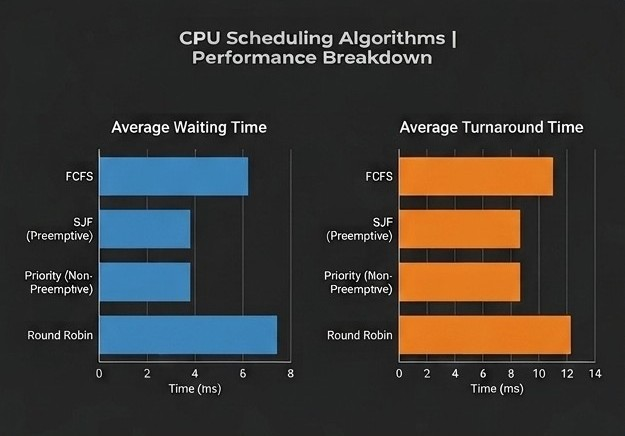

# CPU Scheduling & Banker's Algorithm Simulator

This project is a C++ simulation created to demonstrate core Operating System concepts. It evaluates common CPU scheduling algorithms and includes an implementation of Dijkstra's Banker's Algorithm for deadlock avoidance.

---

What This Project Covers

### 1. CPU Scheduling Algorithms
The simulator tests and compares the performance of several process scheduling strategies:
* First-Come, First-Served (FCFS)
* Shortest Job First (SJF)
* Priority Scheduling (Preemptive & Non-Preemptive)
* Round Robin (RR)
  
It automatically calculates key evaluation metrics:
* Average Waiting Time (WT)
* Average Turnaround Time (TAT)

### 2. Deadlock Avoidance
* Implements the Banker's Algorithm to check system safety states (Safe vs. Unsafe).
* Simulates dynamic resource allocation requests to prevent deadlock scenarios.

---

##  Performance Breakdown

Here is the performance comparison chart generated from the simulation output:

*For more details on the testing methodology and analysis, check out the full [OS Project Report](OS%20Project%20Report.pdf).*

---

##  Repository Structure

* `main.cpp` - Entry point for the simulation program.
* `Scheduler.cpp` - Logic and implementation for the scheduling algorithms.
* `Process.h` - Class and data structures for process properties.
* `performance.png` - Visual chart comparing algorithm efficiency.
* `OS Project Report.pdf` - Complete documentation and project details.

---

###  How to Build and Run

1. Clone the repository:

      https://github.com/RawanFaAlotaibi/CPU-scheduling-and-bankers-algorithm.git
  
2. Move into the project directory:
 
     [cd CPU-scheduling-and-bankers-algorithm](https://github.com/RawanFaAlotaibi/CPU-scheduling-and-bankers-algorithm)

3. Compile the source files:

   [main.cpp](https://github.com/RawanFaAlotaibi/CPU-scheduling-and-bankers-algorithm/blob/main/main.cpp)
   [ Scheduler.cpp](https://github.com/RawanFaAlotaibi/CPU-scheduling-and-bankers-algorithm/blob/main/Scheduler.cpp)
   [Process.h](https://github.com/RawanFaAlotaibi/CPU-scheduling-and-bankers-algorithm/blob/main/Process.h)

4. Run the program:

    [Scheduler.cpp](https://github.com/RawanFaAlotaibi/CPU-scheduling-and-bankers-algorithm/blob/main/Scheduler.cpp)

5. Follow the prompts to enter:

  * Number of processes, and each process's Arrival Time, Burst Time, and Priority
  * Time Quantum for Round Robin
  * Number of resource types, plus the Maximum Demand matrix, Current Allocation matrix, and Available Resource vector for the Banker's Algorithm

---

##  Author
**Rawan Alotaibi**  
Computer Science | Focused on Cybersecurity & SOC Operations  
🔗 [LinkedIn Profile] www.linkedin.com/in/rawan-alotaibi-077318431
